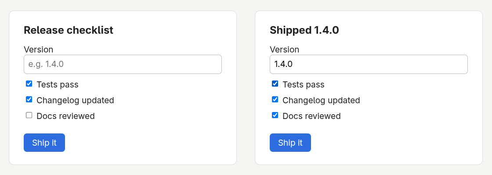

# Puck

Puck lets AI agents see and operate desktop apps on Linux. An agent can take screenshots, read the text on screen, click, type and arrange windows. It works on a private desktop you never see, so the agent can test an app while you keep working, or on your real screen with guardrails. It also shows live agent status in your desktop bar.

Agents reach it as an [MCP](https://modelcontextprotocol.io) server or through the `puck` command line.



An agent opened this page on its private desktop, typed a version, ticked the last box and clicked **Ship it**:

```sh
$ puck open helium-browser --app=http://localhost:8765/
{ "desktop": "private", "window": { "id": "4b4a6520…", "title": "localhost", "width": 1249, "height": 701, … } }

$ puck pointer click 600,297 --window 4b4a6520…     # the Version field
$ puck type --window 4b4a6520… 1.4.0
$ puck pointer click 410,413 --window 4b4a6520…     # Docs reviewed
$ puck pointer click 445,476 --window 4b4a6520…     # Ship it

$ puck inspect --window 4b4a6520… --json
{
  "desktop": "private",
  "window": {
    "app_id": "chrome-localhost__-Default",
    "title": "Release checklist",
    "exe": "/opt/helium-browser-bin/helium",
    "url": "http://localhost:8765/",
    …
  },
  "text": {
    "source": "accessibility",
    "content": "Shipped 1.4.0\nVersion\n1.4.0\nShip it"
  }
}
```

`inspect` reads text from the app's accessibility tree when it has one, and falls back to OCR (for terminals, games, images) when it doesn't.

## Your screen or a private one

**Private desktop.** [Ward](https://github.com/Axl47/ward) gives each agent its own headless desktop. `puck open CMD` starts it if needed, runs the command there and prints the window it opened. Everything on it belongs to the agent, so clicking, typing and closing windows always work.

**Your screen.** Agents can look freely, but anything that could disrupt you is held back:

- Clicking, typing and closing windows are off unless you start the server with `PUCK_INVASIVE=1`.
- Input is refused while a launcher, panel or picker has the keyboard, so keystrokes can't land in the wrong place.
- `PUCK_OUTPUTS=DP-2` keeps the agent on the monitors you name.
- An agent can snapshot your window layout before rearranging it and put it back afterwards.

If Puck can't tell for certain which desktop an agent should use, it refuses rather than falling back to your screen.

## Tools

| Tier | MCP tools | CLI |
|---|---|---|
| Observe | `desktop_state`, `screenshot`, `inspect`, `notifications` | `puck state`, `puck inspect`, `puck pointer` |
| Arrange | `launch_app`, `focus_window`, `move_window`, `arrange_windows`, `switch_workspace`, `layout_snapshot`, `layout_restore`, `dismiss_notification`, `shell_settings` | `puck open`, `puck snapshot`, `puck restore` |
| Invasive | `click`, `drag`, `scroll`, `pointer_move`, `type_text`, `press_keys`, `close_window`, `kill_window` | `puck pointer click\|drag\|scroll\|move`, `puck type`, `puck keys`, `puck focus` |

`run` makes several of these calls in one, with waits between them (for a window, for text to show, or a delay), so an agent can act and see the result without a model turn per step.

Screenshots are scaled to about 1,600 px on the long edge, so one costs an agent around 1.6k tokens.

## Requirements

Puck is built for one desktop stack and talks to it directly:

- [Umbriel](https://aur.archlinux.org/packages/umbriel-git), a Wayland compositor, with `grim` for screenshots and `wtype` for typing
- [Noctalia](https://aur.archlinux.org/packages/noctalia), a desktop shell, for the bar widget, notifications and shell settings
- [Ward](https://github.com/Axl47/ward) for private desktops
- Node 22+ and pnpm
- `python3` with `python-gobject` and `at-spi2-core` for accessibility text, and `tesseract` with English data for OCR

## Setup

```sh
pnpm install && pnpm build
ln -sf "$PWD/dist/cli.js" ~/.local/bin/puck
```

Register `puck mcp` as a stdio MCP server in your agent, for example:

```sh
claude mcp add puck -- puck mcp
```

### Bar widget

The widget shows what your [T3 Code](https://github.com/pingdotgg/t3code) agents are doing. It needs a read-only T3 Code token:

```sh
mkdir -p ~/.config/puck && umask 077
t3 auth session issue --scope orchestration:read --scope diagnostics:read \
  --ttl 365d --label puck --token-only > ~/.config/puck/t3-token

noctalia msg plugins source add puck path "$PWD/plugin"
noctalia msg plugins enable axl47/puck
# then add "axl47/puck:status" to a bar section, e.g. bar.default.end
```

## More

- [docs/reference.md](docs/reference.md): how Puck picks a desktop, the full CLI, pickers, OCR, accessibility setup for browsers, environment variables
- [DESIGN.md](DESIGN.md): how it works and why

## Development

```sh
pnpm test
pnpm typecheck
scripts/agentic-test.sh "On PUCK-SBX, open Zed and Helium side by side"   # a real agent in a sandbox
```
